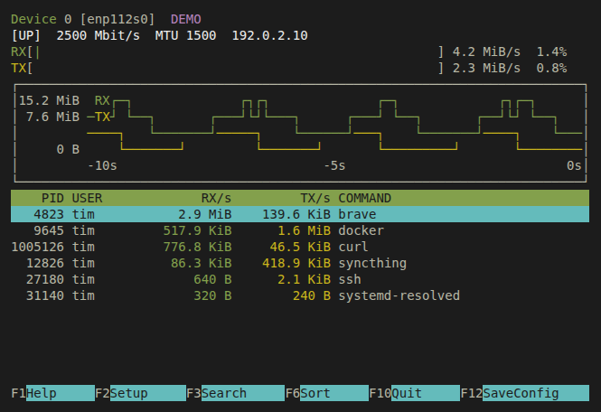

<p align="center">
  <a href="https://nwtop.wutz.io">
    
  </a>
</p>

<p align="center">
  <strong>Linux network activity. Right in your terminal.</strong><br>
  Live traffic graphs, process rates, and F2 Setup — inspired by htop and nvtop.
</p>

<p align="center">
  
  <a href="Cargo.toml"></a>
  <a href="LICENSE"></a>
</p>

<p align="center">
  <a href="https://nwtop.wutz.io">Website</a> ·
  <a href="#install">Install</a> ·
  <a href="#keyboard">Keyboard</a> ·
  <a href="https://github.com/itmitalles-software/nwtop">Source</a>
</p>

**nwtop** (formerly nettop) puts interface traffic, process activity, and individual connections
in one compact view. Green for receive, yellow for send, stepped history graphs,
and your terminal's own ANSI palette. The layout works in a split terminal,
including 36 × 16 and 52 × 18.

**Start without sudo after a one-time capture setup.** The interface runs as your
regular user; a separate helper provides the access needed for process traffic.
Interface counters also work without that setup.

<p align="center">
  
  <br>
  <sub>Actual terminal output in explicit DEMO mode. The displayed traffic is synthetic.</sub>
</p>

| At a glance | Under your control |
| --- | --- |
| **Traffic over time** | RX/TX history, link-speed bars, bytes or bits per second |
| **Processes and connections** | Sort by traffic, receive, send, total, PID, or command; search the table |
| **A familiar terminal UI** | Native colors, inverse headers, keyboard navigation, and a function-key bar |
| **F2 Setup** | Change the interface, refresh rate, graph, colors, and table; save with F12 |

## Install

You need **Linux** (x86_64 or aarch64, glibc 2.35+, e.g. Ubuntu 22.04 or newer)
and the **libpcap runtime** for process capture.

### From a release

```bash
# Ubuntu/Debian: capture runtime and capability tools.
sudo apt install libpcap0.8t64 libcap2-bin   # libpcap0.8 on older releases

version=0.1.0 arch=$(uname -m)
curl -LO https://github.com/itmitalles-software/nwtop/releases/download/v$version/nwtop-$version-$arch-linux.tar.gz
curl -LO https://github.com/itmitalles-software/nwtop/releases/download/v$version/SHA256SUMS
sha256sum --check --ignore-missing SHA256SUMS
tar xzf nwtop-$version-$arch-linux.tar.gz && cd nwtop-$version-$arch-linux
./scripts/install.sh               # Installs ~/.local/bin/nwtop.
./scripts/setup-capture.sh         # One-time administrator authentication.
nwtop
```

### From source

Needs **Rust 1.88+**; a libpcap development package is not required.

```bash
git clone https://github.com/itmitalles-software/nwtop.git
cd nwtop
./scripts/install.sh
./scripts/setup-capture.sh       # One-time administrator authentication.
nwtop
```

Add `~/.local/bin` to your `PATH`. Start both scripts as your regular user,
without sudo; rerun them to update. Without libpcap or capture setup,
`nwtop --no-capture` shows interface counters and accessible socket lists, and
unavailable process rates appear as `-`.

The UI never has capabilities. The helper `/usr/local/libexec/nwtop-collector`
is root-owned and usable by your primary group: **members of that group can
monitor system-wide network metadata**, so setup refuses shared groups unless
you pass `--allow-shared-group`. How the helper is installed, verified,
restricted and revoked is described in [docs/capture-helper.md](docs/capture-helper.md).

**Experimental:** an optional eBPF backend improves attribution of very
short-lived sockets and container published ports. It is source-only, needs
extra capabilities and kernel support, and receives bug fixes only. See
[docs/extended-attribution.md](docs/extended-attribution.md).

## Use

```bash
nwtop --interface eth0          # Select a network interface.
nwtop --interface all           # Include virtual interfaces in the aggregate.
nwtop --interval 0.5 --history 90
nwtop --bits                    # Display rates in bits per second.
nwtop --bytes                   # Override saved bit/s units.
nwtop --no-color                # Start in monochrome.
nwtop --no-capture              # Interface counters and accessible sockets.
nwtop --once                    # Print one measured snapshot and exit.
nwtop --json                    # Print a JSON snapshot and exit.
nwtop --demo                    # Clearly labeled synthetic UI preview.
```

The default refresh interval is **1 second**; `--interval` / `-d` accepts
0.1–60 seconds. History defaults to **60 seconds**; `--history` accepts 10–600.
`-i` selects an interface and `-b` starts in bits per second.

## Keyboard

| Key | Action |
| --- | --- |
| <kbd>F1</kbd> / `?` | Help |
| <kbd>F2</kbd> | Open Setup |
| <kbd>F3</kbd> / `/` | Search the table |
| <kbd>F4</kbd> / `c` | Switch between processes and connections |
| <kbd>F5</kbd> / `i` | Choose an interface with arrows and Enter |
| <kbd>F6</kbd> | Choose a sort column; `s` cycles sorting |
| <kbd>F9</kbd> / Space | Pause or resume the display |
| <kbd>F12</kbd> | Save current settings |
| Tab / Shift+Tab | Cycle active interfaces and loopback |
| `b` | Toggle bytes / bits |
| ↑ / ↓, `k` / `j` | Move through the table |
| Page Up / Page Down, Home / End | Move by a page or jump to the ends |
| Enter / Esc | Apply search / clear search or close a picker |
| `q` / <kbd>F10</kbd> / Ctrl+C | Quit; `q` closes overlays and F10 returns from Setup |

Help scrolls with ↑ / ↓ and Page Up / Page Down. The table starts directly below
the graph; routine capture details live in F1 Help. Notices, search/filter state,
and capture warnings get a status row when needed.

### Make it yours with F2

Setup has **General**, **Interface**, **Chart**, and **Processes** panels. Change
the refresh interval, units, language, interface, history, Steps/Braille drawing,
RX/TX colors, view, sorting, and idle-row visibility. Hide the graph to give the
table more room.

The terminal interface is available in English and German. **Auto** follows
`LC_ALL`, `LC_MESSAGES`, or `LANG` (German for `de*` locales, otherwise English);
General › Language selects English or German explicitly. Command-line help,
errors, and `--json` output stay English.

Use ↑ / ↓ to navigate, Tab or → to enter the options, and ← to return to the
categories. Enter, Space, or `+` changes a value; `-` goes backward. Changes apply
immediately. **F10 or Esc returns to monitoring. F12 saves for the next start.**
Exiting without F12 keeps changes only for the current session.

<details>
<summary><strong>Settings file and command-line overrides</strong></summary>

Settings are saved atomically with private file permissions to
`$XDG_CONFIG_HOME/nwtop/config.json`, or `~/.config/nwtop/config.json` when
`XDG_CONFIG_HOME` is unset, empty, or relative.

Explicit CLI options override saved preferences for that run only. `--no-color`
and a nonempty `NO_COLOR` environment variable start in monochrome. F12 keeps the
saved values and adds only what you changed in Setup or with keys, so overrides
are saved only when you change that setting yourself.

Malformed or unsupported settings produce a warning and use defaults. Saving
preserves the original file until it is fixed or moved aside. Unknown keys, such
as typos, produce a warning and are kept when saving. If a saved interface no
longer exists, nwtop warns and selects an interface automatically for that run;
the saved choice remains until you choose another one. Run nwtop without sudo:
as root it refuses to save into another user's settings directory.

</details>

## What the numbers mean

Interface rates come from **kernel byte counters**. Process and connection rates
come from **captured TCP/UDP IP packets**, matched to socket inodes and PIDs.
Socket queue lengths are never used as traffic estimates.

Attribution has limits. Missing capture, dropped packets, and unattributed
traffic stay visible; unavailable measurements are never replaced with demo
data. Interface totals and process totals can differ, and short-lived or shared
sockets can stay unattributed. Packet headers are interpreted; payloads are not
logged, and nwtop does not perform DNS lookups. Details:
[docs/measurements.md](docs/measurements.md).

## Development

nwtop is written in Rust. Build and run the core checks with:

```bash
cargo fmt --check
cargo clippy --locked --all-targets -- -D warnings
cargo test --locked
cargo build --release --locked
shellcheck scripts/*.sh tests/*.sh
bash tests/release_layout.sh target/release
python3 tests/terminal.py target/release/nwtop
python3 tests/setup.py target/release/nwtop
```

Isolated capture tests, CI coverage and the release process are described in
[docs/development.md](docs/development.md); the
[source map](.agent/ARCHITECTURE.md#source-inventory-and-refactoring-boundaries-22)
describes the module boundaries. See [AGENTS.md](AGENTS.md) for
repository-specific contributor instructions.

The [project website](https://nwtop.wutz.io) is a dependency-free static site in
[`site/`](site/), published by the [Pages workflow](.github/workflows/pages.yml).
Its terminal images and recording use explicit DEMO mode with synthetic traffic.

## License

Copyright (C) 2026 itmitalles

nwtop is free software: you can redistribute it and/or modify it under the
terms of the GNU General Public License as published by the Free Software
Foundation, either version 3 of the License, or (at your option) any later
version (SPDX: `GPL-3.0-or-later`). nwtop is distributed in the hope that it
will be useful, but WITHOUT ANY WARRANTY; without even the implied warranty of
MERCHANTABILITY or FITNESS FOR A PARTICULAR PURPOSE. See [LICENSE](LICENSE) for
the full license text.

---

[GPL-3.0-or-later](LICENSE) · Inspired by htop and nvtop · No affiliation with other
projects named nettop or ntop.

### Upgrading from nettop

The executable and capture helper are now `nwtop` and `nwtop-collector`; the
website moved from nettop.wutz.io to https://nwtop.wutz.io. Run both installation
scripts again. Existing `nettop/config.json` preferences are read when no nwtop
configuration exists; saving writes `nwtop/config.json` and leaves the old file
intact. This migration will be removed in a later release.

After verifying nwtop, remove `~/.local/bin/nettop` and
`~/.local/bin/.nettop-install.sha256`. To retire the old privileged helper, an
administrator must also remove `/usr/local/libexec/nettop-collector` and
`/usr/local/libexec/.nettop-collector.sha256`.
